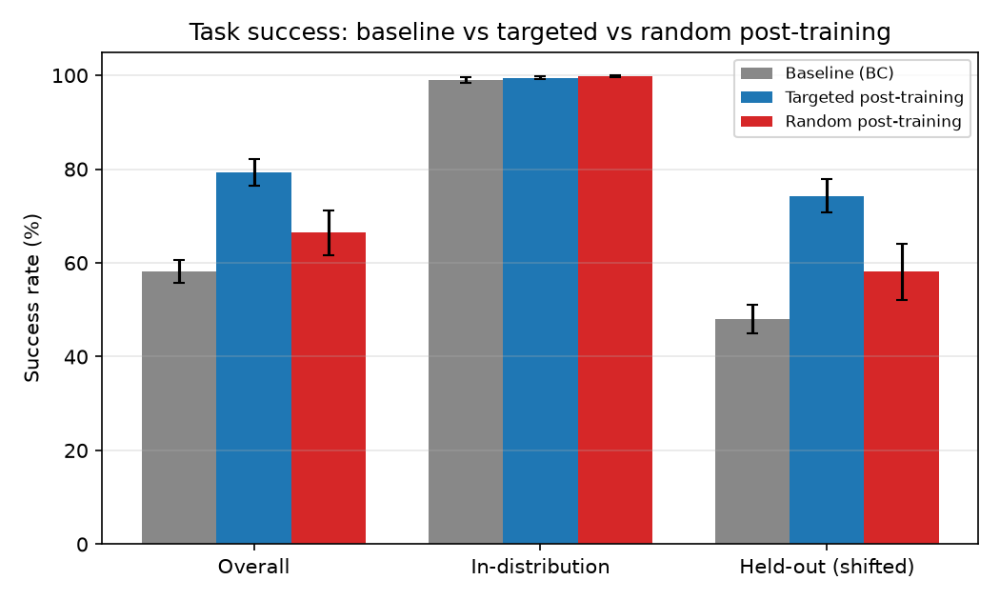
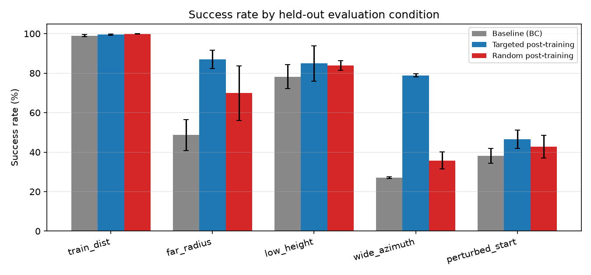
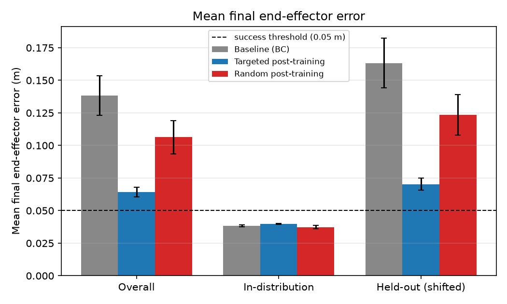
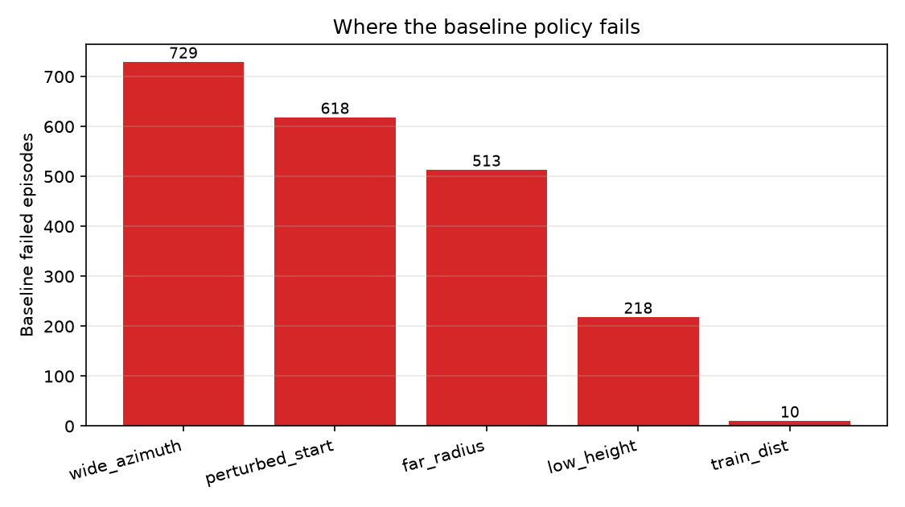

# Robot Skill Post-Training & Evaluation

Failure-focused post-training of a learned robot reaching policy, with a controlled
ablation against matched-volume random data. PyBullet + PyTorch, CPU-only, one command.

```bash
python scripts/run_all.py
```

## Problem

Learned robotic policies trained by behavioural cloning fit their demonstration
distribution well but degrade on conditions outside it. Knowing *that* a policy is worse
out-of-distribution is not actionable; knowing *where* it fails is.

## Hypothesis

> Targeting post-training data toward observed policy failures improves difficult-condition
> performance and generalisation more efficiently than adding the same volume of randomly
> sampled training-distribution data.

## Approach

Expert demonstrations -> behavioural cloning -> held-out benchmark -> failure analysis ->
targeted corrective data -> post-training -> matched random-data ablation.

## Environment

- Simulator: PyBullet `DIRECT` mode. Robot: 7-DoF KUKA iiwa (`kuka_iiwa/model.urdf`).
- Kinematic position control: `q_{t+1} = clip(q_t + 0.05 * a_t, joint_limits)`.
  PyBullet supplies the model, forward kinematics and the IK solver; rigid-body dynamics
  are deliberately not integrated, which keeps the study about policy learning.
- Observation (16-D): 7 joint positions, 3-D end-effector position, 3-D target,
  3-D (target - end-effector). Action (7-D): normalised joint deltas in [-1, 1].
- Expert: PyBullet inverse kinematics + clipped joint-space servoing.

## Experimental design

**Train / validation / test separation.**
300 expert demonstration episodes are drawn from the training distribution only
(radius 0.40-0.65 m, azimuth +/-60 deg, height 0.25-0.65 m, start-pose noise sigma=0.10 rad),
split at the *episode* level into 2075 train and 357 validation
transitions so no transition leaks across the split.

**Held-out benchmark.** Five conditions, one in-distribution control and four distribution
shifts, 200 episodes each (1000 episodes per seed), built once
from a fixed seed (`BENCHMARK_SEED=1234`) and reused unchanged by every model:

| condition | shift | held-out |
| --- | --- | :-: |
| `train_dist` | none (in-distribution control) | no |
| `far_radius` | target radius 0.65-0.78 m (beyond training reach band) | yes |
| `low_height` | target height 0.08-0.25 m (below training band) | yes |
| `wide_azimuth` | target azimuth 60-115 deg (outside training sector) | yes |
| `perturbed_start` | start-pose noise sigma=0.60 rad (6x training) | yes |

Every benchmark episode is **expert-verified solvable** before admission, so the expert
ceiling on this benchmark is 100.0% and every policy failure is a
policy failure, not an unreachable target.

**No test-set leakage.** Corrective data is mined from a *separate dev pool* built with a
different seed (`DEV_SEED=4321`) over the same condition definitions. The test
benchmark is never used to generate training data.

**Controlled ablation.** Both post-training arms start from the same baseline checkpoint and
share: architecture, frozen observation normaliser, optimiser (Adam), learning rate
(0.0003), epochs (30), batch size (256), gradient steps (210),
total post-training transitions (1600 = 800 new + 800 replay from
the original training split), evaluation benchmark and evaluation seeds. The **only**
difference is the source of the new transitions:

- **Targeted**: expert corrective rollouts restarted from states the baseline actually
  visited on episodes it failed (a DAgger-style relabelling of failure states).
- **Random**: transitions sampled uniformly from a fresh expert demonstration pool drawn
  from the original training distribution.

**Seeds.** Dataset seed, benchmark seed and dev seed are fixed constants; the full
train -> mine -> post-train -> evaluate loop is repeated for 5 training seeds
([0, 1, 2, 3, 4]) and results are reported as mean +/- std across them.

**Metrics.** Success rate (primary), mean final end-effector error, failure count and mean
steps per episode. Success is defined once: end-effector within 0.05 m of
the target within 60 steps. Thresholds, benchmark composition and seeds were
fixed before any result was seen and were not changed afterwards.

## Results

All numbers are measured, averaged over 5 training seeds on the identical
1000-episode benchmark. "Held-out" is the mean over the four shifted conditions.

| Experiment | Overall success | In-distribution | Held-out success | Mean final error |
| --- | ---: | ---: | ---: | ---: |
| Baseline (BC) | 58.2% +/- 2.7 pp | 99.0% | 48.0% +/- 3.4 pp | 0.1383 m |
| Targeted post-training | 79.4% +/- 3.2 pp | 99.5% | 74.3% +/- 3.9 pp | 0.0642 m |
| Random post-training | 66.5% +/- 5.4 pp | 99.9% | 58.1% +/- 6.7 pp | 0.1063 m |
| _Expert (ceiling)_ | _100.0%_ | _100.0%_ | _100.0%_ | _-_ |

### Success rate by condition (baseline vs targeted vs random)

| condition | baseline | targeted | random | targeted - baseline | targeted - random |
| --- | ---: | ---: | ---: | ---: | ---: |
| `wide_azimuth` | 27.1% | 78.9% | 35.8% | +51.8 pp | +43.1 pp |
| `perturbed_start` | 38.2% | 46.5% | 42.8% | +8.3 pp | +3.7 pp |
| `far_radius` | 48.7% | 87.0% | 69.9% | +38.3 pp | +17.1 pp |
| `low_height` | 78.2% | 84.9% | 83.9% | +6.7 pp | +1.0 pp |
| `train_dist` | 99.0% | 99.5% | 99.9% | +0.5 pp | -0.4 pp |

**Ablation.** Targeted minus random: +12.9 pp overall, +16.2 pp held-out.
Because both arms are fine-tuned from the *same* per-seed checkpoint on the *same*
benchmark, the comparison can be paired by seed:

| paired held-out delta | mean | std | seeds won |
| --- | ---: | ---: | ---: |
| targeted - baseline | +26.3 pp | 5.9 | 5/5 |
| random - baseline | +10.0 pp | 5.1 | 5/5 |
| targeted - random | +16.2 pp | 7.2 | 5/5 |

Both post-training arms help, but targeting helps more. Per-seed values are in
`results/paired_seed_deltas.csv`. No significance test is claimed at this sample size.




Mean final end-effector error tracks the same ordering, so the success-rate gains are not
threshold artefacts - the post-trained policies end genuinely closer to the target:



## Failure analysis

The baseline failed 2088 of 5000 benchmark episodes
across 5 seeds. Failures are strongly non-uniform:

| condition | episodes | failures | success rate | mean final error | mean steps |
| --- | ---: | ---: | ---: | ---: | ---: |
| `wide_azimuth` | 1000 | 729 | 27.1% | 0.3279 m | 47.3 |
| `perturbed_start` | 1000 | 618 | 38.2% | 0.1397 m | 44.9 |
| `far_radius` | 1000 | 513 | 48.7% | 0.1152 m | 35.2 |
| `low_height` | 1000 | 218 | 78.2% | 0.0703 m | 21.6 |
| `train_dist` | 1000 | 10 | 99.0% | 0.0383 m | 9.0 |

The dominant failure condition is **`wide_azimuth`** (27.1% success,
729 failures). Machine-readable output: `results/failure_analysis.csv`.

Failures also take far longer before giving up: mean steps rises from
9.0 in-distribution to
47.3 on the hardest condition (the 60-step cap), i.e. the
policy does not simply overshoot - it stalls without converging on the target.

**The corrective data self-targets.** Failure mining was given a flat budget and no
instruction about which conditions matter; it spent that budget where the policy actually
failed (mean transitions per seed):

| condition | corrective transitions | share |
| --- | ---: | ---: |
| `wide_azimuth` | 425 | 51.9% |
| `perturbed_start` | 238 | 29.0% |
| `far_radius` | 104 | 12.7% |
| `low_height` | 52 | 6.3% |



## Reproducing

```bash
python -m venv .venv && source .venv/bin/activate
pip install -r requirements.txt
python scripts/run_all.py          # full experiment
python scripts/run_all.py --quick  # ~1 min smoke test
python -m pytest tests/ -q         # unit tests
```

Every experiment constant lives in `src/config.py`. Total runtime measured on an 8-core CPU (no GPU): **1.0 min**.

**Reproducibility is verified, not asserted.** Two independent full runs of
`scripts/run_all.py` produce byte-identical `results/episodes.csv` and
`results/comparison.csv`. Every stochastic component is seeded, including PyTorch weight
initialisation (seeded *before* module construction), dataset sampling, the train/val
split, DataLoader shuffling, benchmark generation and corrective-data selection.

> **Setup note (macOS).** PyBullet ships no wheels, so `pip install pybullet` compiles from
> source and needs Python <= 3.12. On recent macOS SDKs the bundled zlib defines
> `fdopen(fd, mode) NULL`, which collides with `<stdio.h>` and breaks the build; delete that
> line in `examples/ThirdPartyLibs/zlib/zutil.h` before building.

Outputs: `results/metrics.csv` (per-condition, per-model, per-seed), `results/failure_analysis.csv`, `results/comparison.csv`, `results/episodes.csv` (every episode), `results/run_provenance.csv` (data/gradient-step budgets), `results/plots/`, `results/RESUME_RESULTS.md`.

## Limitations

- **Simulation only.** No real robot, no sim-to-real transfer, no hardware validation.
- **Kinematic, not dynamic.** Joint positions are set directly; contact, inertia, torque
  limits and actuator lag are not simulated, so the control problem is easier than a real one.
- **Single simple task.** Free-space 3-D reaching with a known target position. No
  perception, no obstacles, no grasping, no long-horizon manipulation.
- **Small policy and dataset.** A 2-hidden-layer MLP trained on a few thousand transitions;
  conclusions may not carry to large policies or high-dimensional observations.
- **Limited statistical power.** 5 training seeds on a single fixed benchmark;
  standard deviations are reported but no significance test is claimed.
- **Distribution shifts are hand-specified**, not naturally occurring, and the corrective
  data uses the same condition families as the benchmark (different seeds, disjoint
  episodes) - a favourable setting for targeting.
